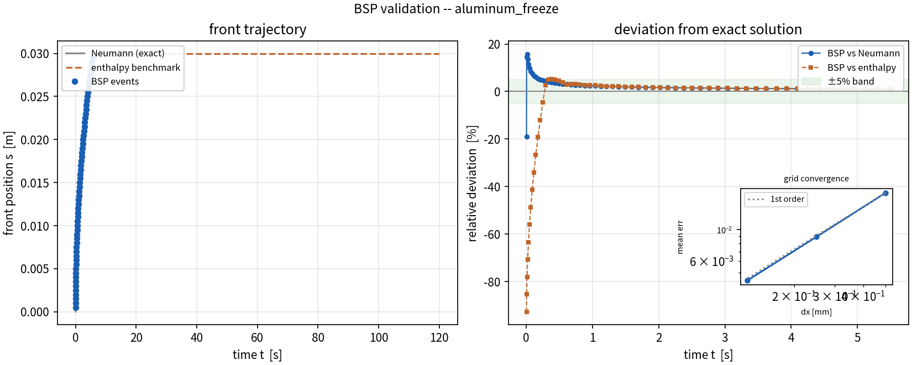
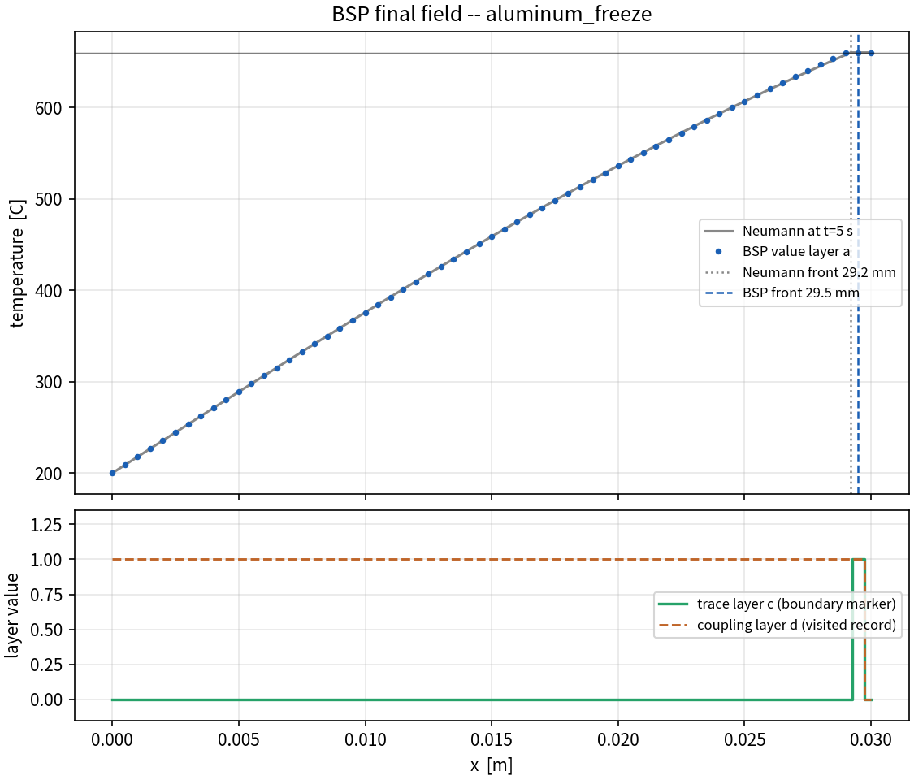
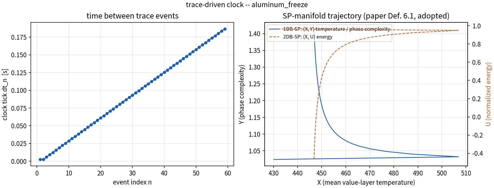

# BSP validation report -- aluminum_freeze

Generated by `bsp` -- the Bitriada Stefan Projection validation workbench. Every claim of the BSP paper that this case can test has been checked; the verdicts and numbers are below.

## Case

- mode: **freezing**, T_m = 660.3 C, T_s = 200.0, T_0 = 660.3
- domain: L = 0.03 m, dx = 0.0005 m (60 cells), t_end = 120.0 s
- material: rho = 2700.0 kg/m3, L = 397000.0 J/kg, k_grown = 237.0, cp_grown = 900.0, k_bulk = 237.0, cp_bulk = 900.0
- Neumann constant: lambda = 0.6305 (Ste = 1.0435)
- run: 59 events, 9565 diffusion substeps, termination: front reached domain end

## Soundness checks

| verdict | check | claim tested | measured | tolerance |
|---|---|---|---|---|
| **PASS** | `neumann_agreement` | Thm 12.1: BSP event positions track s(t) = 2*lam*sqrt(alpha t) | mean rel err 1.818% (max 3.384%, 39 events in window) | mean < 10% (marginal < 20%) |
| **PASS** | `convergence` | Thm 12.1 (dx -> 0): BSP event times converge to Neumann | order ~ 1.02 (pairwise 1.03, 1.02); errs 1.818%, 0.892%, 0.439% | fitted order >= 0.7, errors decreasing |
| **PASS** | `enthalpy_agreement` | independent benchmark: apparent-capacity enthalpy method (refined grid dx/4) | mean rel diff 1.931% over 39 events | mean < 10% |
| **MARGINAL** | `energy_conservation` | Thm 13.2: energy conserved at each trace event up to the boundary flux (E_after - E_before + Q_out = 0) | max per-event drift 5.855% of one cell's latent; cumulative drift 0.666% of total latent exchanged | both < 5% (marginal < 15%) |
| **PASS** | `second_law` | Thm 14.1: entropy production dS = k (grad T)^2 / T^2 dt >= 0, cumulative S monotone | min dS = 0.000e+00 J/(m2 K), S(t_end) = 40090.3218 J/(m2 K), monotone: True | dS >= 0 and S non-decreasing |
| **PASS** | `sharp_interface` | Prop 9.3 (tau^2 = 0): the boundary marker never smears -- exactly one interface node at all times | interface nodes at end: 1; front advances node-by-node (all dp = 1): True | exactly 1, dp = 1 |
| **PASS** | `trace_clock` | Prop 9.2: time emerges from trace events -- strictly increasing, non-uniform clock ticks | 59 events, dt in [0.0025, 0.19] s (span ratio 76.0), decelerating front captured without any adaptive time-step controller | t increasing, dt > 0, non-uniform |
| **PASS** | `null_transit` | monograph sec. 2.7.1 via bsp.nodes: nilpotent, irreversible, trace-preserving layer switch at node 0 | fare_1 = -1095214.5 vs expected -1095214.5 (0.00% of rho L dx); visited record d = 1 on all 60 visited nodes: True; one-way transits: True; max crossing residual 1.27e-04 dx | fare within 2%, record complete, one-way, residual < 1e-3 dx |
| **PASS** | `uc_algebra` | sec. 3: UC algebra with tau^2 = 0 (sharp interface encoding) | tau^2 = 0 exactly: True; Prop 3.2's printed product deviates from the algebra it defines by up to 5.914 (tau-real) / 15.317 (tau-imag) on random samples (value parts agree) | tau^2 = 0 exact |
| **PASS** | `lattice_counts` | sec. 4: 1DB = 117 = 9 + 27 + 81 points, 2DB = 243 positions, value tables as printed | 1DB points: 117, L-table match: True, M-table match: True, 2DB zone accounting: (351, 243) | all counts and tables match |

- **neumann_agreement**: measured on the mid-window events (start-up excluded); the convergence check below is the dx -> 0 statement
- **convergence**: grids dx = 0.500, 0.250, 0.125 mm; node-pinned front tracking is expected to be ~1st order
- **enthalpy_agreement**: two independent discretizations agreeing is the strongest simple evidence of correctness
- **energy_conservation**: event 1 excluded: it carries the null-transit fare (first cell's latent + boundary-cell chill), O(dx), a start-up payment rather than a conservation failure
- **second_law**: dS uses the paper's formula with absolute temperature and the dx volume element added (per-unit area)
- **sharp_interface**: the trace layer c is 0/1 by construction and tau^2 = 0 keeps multiplication from smearing it (uc_algebra below)
- **trace_clock**: for a sqrt(t) front the intervals grow linearly with event index; the uniform-grid alternative would need dt small enough for the fastest early event
- **null_transit**: the start-up node-0 conflict (boundary layer T_s vs interface layer T_m) is resolved by dynamic layer switching; the fare is O(dx) and vanishes in the convergence limit
- **uc_algebra**: bsp.uc implements the correct Leibniz product; the paper's Prop 3.2 drops the -bd'-b'd contribution and flips a sign -- see the audit report
- **lattice_counts**: finding: the lattices are sound combinatorial objects but Algorithm 9.1 never uses them (it runs on a plain uniform lattice); they are not load-bearing for the solver

## Grid convergence (Theorem 12.1)

| dx [mm] | events | mean err vs Neumann | max err | enthalpy diff (matched dx) |
|---|---|---|---|---|
| 0.5000 | 59 | 1.818% | 3.384% | 1.837% |
| 0.2500 | 119 | 0.892% | 1.678% | 0.982% |
| 0.1250 | 239 | 0.439% | 0.829% | 0.527% |

Fitted order of accuracy: **1.02** (node-pinned front tracking is expected to be ~1st order).

## Event log (first 15)

| n | t [s] | dt [s] | s [m] | v_eff [m/s] | fare [J/m2] | dS [J/m2K] | transit |
|---|---|---|---|---|---|---|---|
| 1 | 0.00 | 0.00 | 0.0005 | 2.035e-01 | -1095214.5 | 0.000e+00 | null |
| 2 | 0.00 | 0.00 | 0.0010 | 2.035e-01 | 0.0 | 0.000e+00 | advance |
| 3 | 0.01 | 0.01 | 0.0015 | 8.469e-02 | -31378.9 | 2.671e+02 | advance |
| 4 | 0.02 | 0.01 | 0.0020 | 5.440e-02 | -20627.9 | 4.289e+02 | advance |
| 5 | 0.03 | 0.01 | 0.0025 | 4.016e-02 | -15260.8 | 5.123e+02 | advance |
| 6 | 0.05 | 0.02 | 0.0030 | 3.186e-02 | -12054.5 | 5.627e+02 | advance |
| 7 | 0.07 | 0.02 | 0.0035 | 2.641e-02 | -9898.4 | 5.965e+02 | advance |
| 8 | 0.09 | 0.02 | 0.0040 | 2.255e-02 | -8406.7 | 6.207e+02 | advance |
| 9 | 0.11 | 0.03 | 0.0045 | 1.968e-02 | -7296.8 | 6.390e+02 | advance |
| 10 | 0.14 | 0.03 | 0.0050 | 1.746e-02 | -6424.3 | 6.533e+02 | advance |
| 11 | 0.18 | 0.03 | 0.0055 | 1.569e-02 | -5747.0 | 6.648e+02 | advance |
| 12 | 0.21 | 0.04 | 0.0060 | 1.425e-02 | -5185.6 | 6.742e+02 | advance |
| 13 | 0.25 | 0.04 | 0.0065 | 1.305e-02 | -4730.8 | 6.821e+02 | advance |
| 14 | 0.29 | 0.04 | 0.0070 | 1.203e-02 | -4347.7 | 6.888e+02 | advance |
| 15 | 0.33 | 0.04 | 0.0075 | 1.116e-02 | -4014.8 | 6.945e+02 | advance |

(full log in `events.csv`)

## Figures

