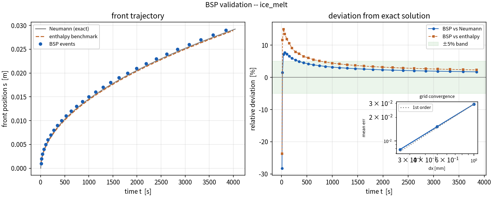
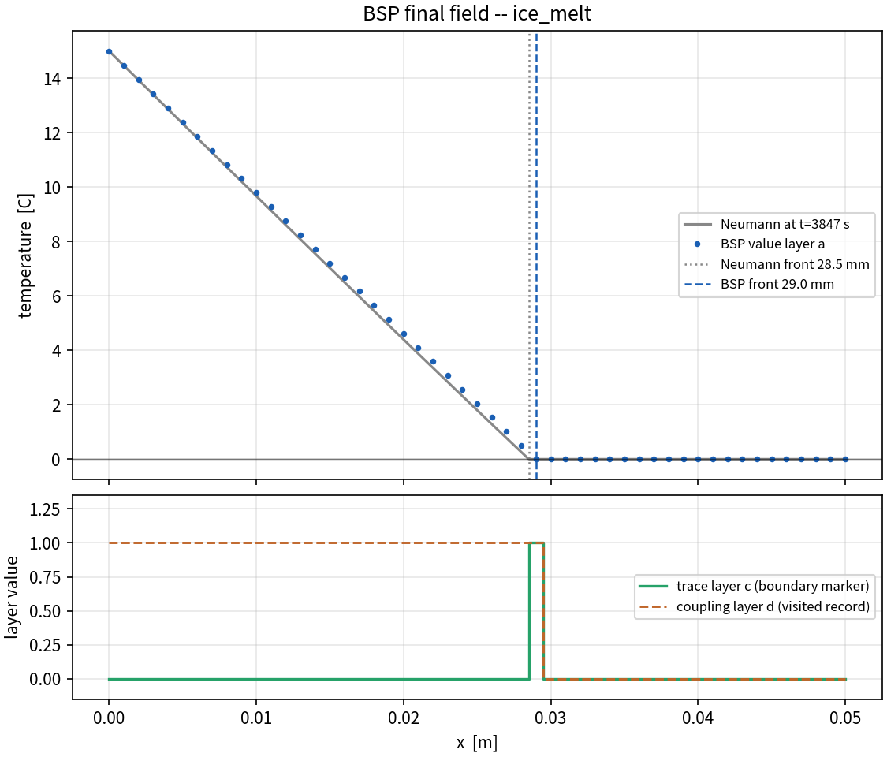
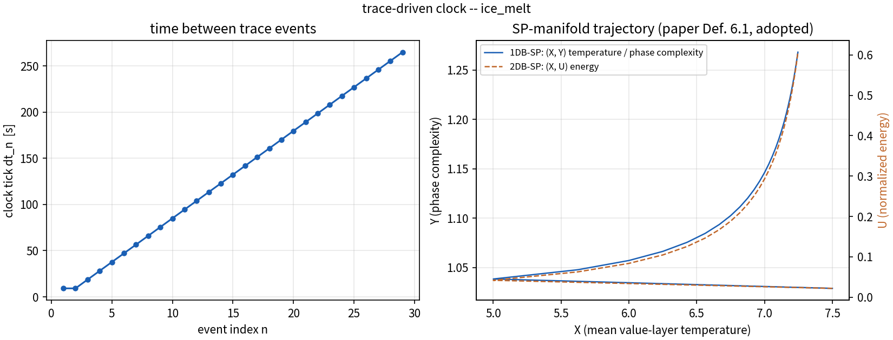

# BSP validation report -- ice_melt

Generated by `bsp` -- the Bitriada Stefan Projection validation workbench. Every claim of the BSP paper that this case can test has been checked; the verdicts and numbers are below.

## Case

- mode: **melting**, T_m = 0.0 C, T_s = 15.0, T_0 = 0.0
- domain: L = 0.05 m, dx = 0.001 m (50 cells), t_end = 4000.0 s
- material: rho = 917.0 kg/m3, L = 333600.0 J/kg, k_grown = 2.22, cp_grown = 2050.0, k_bulk = 0.56, cp_bulk = 4186.0
- Neumann constant: lambda = 0.2115 (Ste = 0.0922)
- run: 29 events, 21011 diffusion substeps, termination: t_end reached

## Soundness checks

| verdict | check | claim tested | measured | tolerance |
|---|---|---|---|---|
| **PASS** | `neumann_agreement` | Thm 12.1: BSP event positions track s(t) = 2*lam*sqrt(alpha t) | mean rel err 2.939% (max 4.937%, 19 events in window) | mean < 10% (marginal < 20%) |
| **PASS** | `convergence` | Thm 12.1 (dx -> 0): BSP event times converge to Neumann | order ~ 0.96 (pairwise 0.96, 0.96); errs 2.939%, 1.515%, 0.777% | fitted order >= 0.7, errors decreasing |
| **PASS** | `enthalpy_agreement` | independent benchmark: apparent-capacity enthalpy method (refined grid dx/4) | mean rel diff 4.104% over 19 events | mean < 10% |
| **PASS** | `energy_conservation` | Thm 13.2: energy conserved at each trace event up to the boundary flux (E_after - E_before + Q_out = 0) | max per-event drift 0.518% of one cell's latent; cumulative drift 0.105% of total latent exchanged | both < 5% (marginal < 15%) |
| **PASS** | `second_law` | Thm 14.1: entropy production dS = k (grad T)^2 / T^2 dt >= 0, cumulative S monotone | min dS = 0.000e+00 J/(m2 K), S(t_end) = 1445.4666 J/(m2 K), monotone: True | dS >= 0 and S non-decreasing |
| **PASS** | `sharp_interface` | Prop 9.3 (tau^2 = 0): the boundary marker never smears -- exactly one interface node at all times | interface nodes at end: 1; front advances node-by-node (all dp = 1): True | exactly 1, dp = 1 |
| **PASS** | `trace_clock` | Prop 9.2: time emerges from trace events -- strictly increasing, non-uniform clock ticks | 29 events, dt in [9.2, 2.6e+02] s (span ratio 28.8), decelerating front captured without any adaptive time-step controller | t increasing, dt > 0, non-uniform |
| **PASS** | `null_transit` | monograph sec. 2.7.1 via bsp.nodes: nilpotent, irreversible, trace-preserving layer switch at node 0 | fare_1 = 334109.0 vs expected 334109.0 (0.00% of rho L dx); visited record d = 1 on all 30 visited nodes: True; one-way transits: True; max crossing residual 1.10e-09 dx | fare within 2%, record complete, one-way, residual < 1e-3 dx |
| **PASS** | `uc_algebra` | sec. 3: UC algebra with tau^2 = 0 (sharp interface encoding) | tau^2 = 0 exactly: True; Prop 3.2's printed product deviates from the algebra it defines by up to 5.914 (tau-real) / 15.317 (tau-imag) on random samples (value parts agree) | tau^2 = 0 exact |
| **PASS** | `lattice_counts` | sec. 4: 1DB = 117 = 9 + 27 + 81 points, 2DB = 243 positions, value tables as printed | 1DB points: 117, L-table match: True, M-table match: True, 2DB zone accounting: (351, 243) | all counts and tables match |

- **neumann_agreement**: measured on the mid-window events (start-up excluded); the convergence check below is the dx -> 0 statement
- **convergence**: grids dx = 1.000, 0.500, 0.250 mm; node-pinned front tracking is expected to be ~1st order
- **enthalpy_agreement**: two independent discretizations agreeing is the strongest simple evidence of correctness
- **energy_conservation**: event 1 excluded: it carries the null-transit fare (first cell's latent + boundary-cell chill), O(dx), a start-up payment rather than a conservation failure
- **second_law**: dS uses the paper's formula with absolute temperature and the dx volume element added (per-unit area)
- **sharp_interface**: the trace layer c is 0/1 by construction and tau^2 = 0 keeps multiplication from smearing it (uc_algebra below)
- **trace_clock**: for a sqrt(t) front the intervals grow linearly with event index; the uniform-grid alternative would need dt small enough for the fastest early event
- **null_transit**: the start-up node-0 conflict (boundary layer T_s vs interface layer T_m) is resolved by dynamic layer switching; the fare is O(dx) and vanishes in the convergence limit
- **uc_algebra**: bsp.uc implements the correct Leibniz product; the paper's Prop 3.2 drops the -bd'-b'd contribution and flips a sign -- see the audit report
- **lattice_counts**: finding: the lattices are sound combinatorial objects but Algorithm 9.1 never uses them (it runs on a plain uniform lattice); they are not load-bearing for the solver

## Grid convergence (Theorem 12.1)

| dx [mm] | events | mean err vs Neumann | max err | enthalpy diff (matched dx) |
|---|---|---|---|---|
| 1.0000 | 29 | 2.939% | 4.937% | 8.561% |
| 0.5000 | 58 | 1.515% | 2.700% | 4.155% |
| 0.2500 | 116 | 0.777% | 1.434% | 2.049% |

Fitted order of accuracy: **0.96** (node-pinned front tracking is expected to be ~1st order).

## Event log (first 15)

| n | t [s] | dt [s] | s [m] | v_eff [m/s] | fare [J/m2] | dS [J/m2K] | transit |
|---|---|---|---|---|---|---|---|
| 1 | 9.19 | 9.19 | 0.0010 | 1.089e-04 | 334109.0 | 0.000e+00 | null |
| 2 | 18.37 | 9.19 | 0.0020 | 1.089e-04 | 0.0 | 0.000e+00 | advance |
| 3 | 37.07 | 18.70 | 0.0030 | 5.347e-05 | 1586.1 | 2.969e+01 | advance |
| 4 | 65.24 | 28.17 | 0.0040 | 3.550e-05 | 1057.4 | 3.992e+01 | advance |
| 5 | 102.88 | 37.64 | 0.0050 | 2.657e-05 | 793.1 | 4.499e+01 | advance |
| 6 | 149.99 | 47.11 | 0.0060 | 2.123e-05 | 634.4 | 4.802e+01 | advance |
| 7 | 206.57 | 56.58 | 0.0070 | 1.768e-05 | 528.7 | 5.004e+01 | advance |
| 8 | 272.61 | 66.05 | 0.0080 | 1.514e-05 | 453.2 | 5.148e+01 | advance |
| 9 | 348.13 | 75.51 | 0.0090 | 1.324e-05 | 396.5 | 5.255e+01 | advance |
| 10 | 433.11 | 84.98 | 0.0100 | 1.177e-05 | 352.5 | 5.339e+01 | advance |
| 11 | 527.56 | 94.45 | 0.0110 | 1.059e-05 | 317.2 | 5.406e+01 | advance |
| 12 | 631.48 | 103.92 | 0.0120 | 9.623e-06 | 288.4 | 5.461e+01 | advance |
| 13 | 744.87 | 113.39 | 0.0130 | 8.819e-06 | 264.3 | 5.506e+01 | advance |
| 14 | 867.73 | 122.86 | 0.0140 | 8.140e-06 | 244.0 | 5.545e+01 | advance |
| 15 | 1000.05 | 132.33 | 0.0150 | 7.557e-06 | 226.6 | 5.578e+01 | advance |

(full log in `events.csv`)

## Figures

