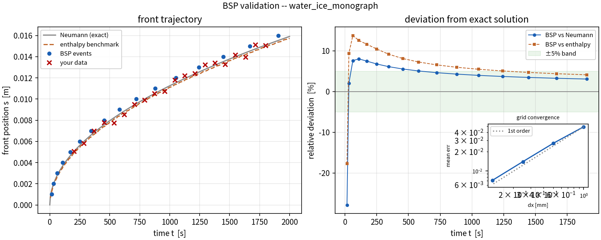
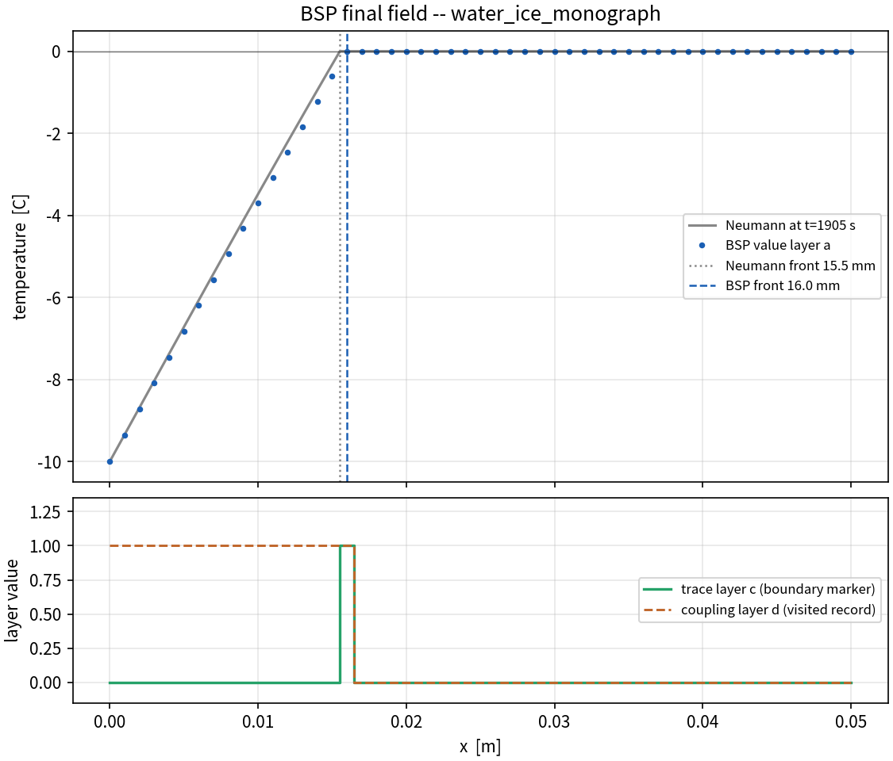
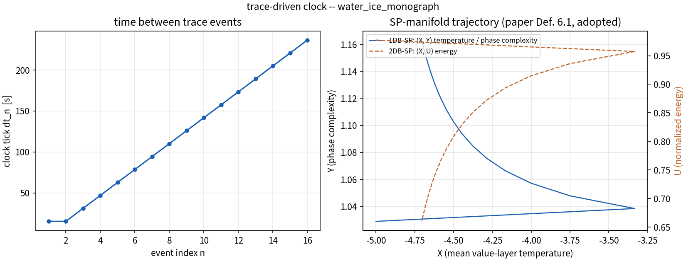

# BSP validation report -- water_ice_monograph

Generated by `bsp` -- the Bitriada Stefan Projection validation workbench. Every claim of the BSP paper that this case can test has been checked; the verdicts and numbers are below.

## Case

- mode: **freezing**, T_m = 0.0 C, T_s = -10.0, T_0 = 0.0
- domain: L = 0.05 m, dx = 0.001 m (50 cells), t_end = 2000.0 s
- material: rho = 1000.0 kg/m3, L = 334000.0 J/kg, k_grown = 2.2, cp_grown = 4186.0, k_bulk = 0.6, cp_bulk = 4186.0
- Neumann constant: lambda = 0.2453 (Ste = 0.1253)
- run: 16 events, 4681 diffusion substeps, termination: t_end reached

## Soundness checks

| verdict | check | claim tested | measured | tolerance |
|---|---|---|---|---|
| **PASS** | `neumann_agreement` | Thm 12.1: BSP event positions track s(t) = 2*lam*sqrt(alpha t) | mean rel err 4.916% (max 7.454%, 11 events in window) | mean < 10% (marginal < 20%) |
| **PASS** | `convergence` | Thm 12.1 (dx -> 0): BSP event times converge to Neumann | order ~ 0.93 (pairwise 0.86, 0.95, 0.97); errs 4.916%, 2.710%, 1.398%, 0.714% | fitted order >= 0.7, errors decreasing |
| **PASS** | `enthalpy_agreement` | independent benchmark: apparent-capacity enthalpy method (refined grid dx/4) | mean rel diff 7.138% over 11 events | mean < 10% |
| **PASS** | `energy_conservation` | Thm 13.2: energy conserved at each trace event up to the boundary flux (E_after - E_before + Q_out = 0) | max per-event drift 0.705% of one cell's latent; cumulative drift 0.204% of total latent exchanged | both < 5% (marginal < 15%) |
| **PASS** | `second_law` | Thm 14.1: entropy production dS = k (grad T)^2 / T^2 dt >= 0, cumulative S monotone | min dS = 0.000e+00 J/(m2 K), S(t_end) = 564.7447 J/(m2 K), monotone: True | dS >= 0 and S non-decreasing |
| **PASS** | `sharp_interface` | Prop 9.3 (tau^2 = 0): the boundary marker never smears -- exactly one interface node at all times | interface nodes at end: 1; front advances node-by-node (all dp = 1): True | exactly 1, dp = 1 |
| **PASS** | `trace_clock` | Prop 9.2: time emerges from trace events -- strictly increasing, non-uniform clock ticks | 16 events, dt in [15, 2.4e+02] s (span ratio 15.6), decelerating front captured without any adaptive time-step controller | t increasing, dt > 0, non-uniform |
| **PASS** | `null_transit` | monograph sec. 2.7.1 via bsp.nodes: nilpotent, irreversible, trace-preserving layer switch at node 0 | fare_1 = -375860.0 vs expected -375860.0 (0.00% of rho L dx); visited record d = 1 on all 17 visited nodes: True; one-way transits: True; max crossing residual 4.56e-09 dx | fare within 2%, record complete, one-way, residual < 1e-3 dx |
| **PASS** | `user_data` | YOUR measurements: BSP front vs observed interface positions (and Neumann as reference) | BSP RMS rel err 5.389%; Neumann RMS rel err 2.595% (20 points) | RMS < 10% (marginal < 25%) |
| **PASS** | `uc_algebra` | sec. 3: UC algebra with tau^2 = 0 (sharp interface encoding) | tau^2 = 0 exactly: True; Prop 3.2's printed product deviates from the algebra it defines by up to 5.914 (tau-real) / 15.317 (tau-imag) on random samples (value parts agree) | tau^2 = 0 exact |
| **PASS** | `lattice_counts` | sec. 4: 1DB = 117 = 9 + 27 + 81 points, 2DB = 243 positions, value tables as printed | 1DB points: 117, L-table match: True, M-table match: True, 2DB zone accounting: (351, 243) | all counts and tables match |

- **neumann_agreement**: measured on the mid-window events (start-up excluded); the convergence check below is the dx -> 0 statement
- **convergence**: grids dx = 1.000, 0.500, 0.250, 0.125 mm; node-pinned front tracking is expected to be ~1st order
- **enthalpy_agreement**: two independent discretizations agreeing is the strongest simple evidence of correctness
- **energy_conservation**: event 1 excluded: it carries the null-transit fare (first cell's latent + boundary-cell chill), O(dx), a start-up payment rather than a conservation failure
- **second_law**: dS uses the paper's formula with absolute temperature and the dx volume element added (per-unit area)
- **sharp_interface**: the trace layer c is 0/1 by construction and tau^2 = 0 keeps multiplication from smearing it (uc_algebra below)
- **trace_clock**: for a sqrt(t) front the intervals grow linearly with event index; the uniform-grid alternative would need dt small enough for the fastest early event
- **null_transit**: the start-up node-0 conflict (boundary layer T_s vs interface layer T_m) is resolved by dynamic layer switching; the fare is O(dx) and vanishes in the convergence limit
- **user_data**: bring your own (time, position) data via the case file's user_data = 'file.csv'
- **uc_algebra**: bsp.uc implements the correct Leibniz product; the paper's Prop 3.2 drops the -bd'-b'd contribution and flips a sign -- see the audit report
- **lattice_counts**: finding: the lattices are sound combinatorial objects but Algorithm 9.1 never uses them (it runs on a plain uniform lattice); they are not load-bearing for the solver

## Grid convergence (Theorem 12.1)

| dx [mm] | events | mean err vs Neumann | max err | enthalpy diff (matched dx) |
|---|---|---|---|---|
| 1.0000 | 16 | 4.916% | 7.454% | 14.054% |
| 0.5000 | 32 | 2.710% | 4.621% | 7.253% |
| 0.2500 | 64 | 1.398% | 2.482% | 3.571% |
| 0.1250 | 127 | 0.714% | 1.305% | 1.750% |

Fitted order of accuracy: **0.93** (node-pinned front tracking is expected to be ~1st order).

## Event log (first 15)

| n | t [s] | dt [s] | s [m] | v_eff [m/s] | fare [J/m2] | dS [J/m2K] | transit |
|---|---|---|---|---|---|---|---|
| 1 | 15.18 | 15.18 | 0.0010 | 6.587e-05 | -375860.0 | 0.000e+00 | null |
| 2 | 30.36 | 15.18 | 0.0020 | 6.587e-05 | 0.0 | 0.000e+00 | advance |
| 3 | 61.46 | 31.10 | 0.0030 | 3.215e-05 | -2354.6 | 2.376e+01 | advance |
| 4 | 108.38 | 46.92 | 0.0040 | 2.131e-05 | -1569.8 | 3.211e+01 | advance |
| 5 | 171.11 | 62.73 | 0.0050 | 1.594e-05 | -1177.3 | 3.622e+01 | advance |
| 6 | 249.66 | 78.55 | 0.0060 | 1.273e-05 | -941.8 | 3.868e+01 | advance |
| 7 | 344.03 | 94.37 | 0.0070 | 1.060e-05 | -784.9 | 4.031e+01 | advance |
| 8 | 454.21 | 110.18 | 0.0080 | 9.076e-06 | -672.7 | 4.148e+01 | advance |
| 9 | 580.21 | 126.00 | 0.0090 | 7.937e-06 | -588.7 | 4.235e+01 | advance |
| 10 | 722.02 | 141.81 | 0.0100 | 7.052e-06 | -523.2 | 4.303e+01 | advance |
| 11 | 879.65 | 157.63 | 0.0110 | 6.344e-06 | -470.9 | 4.357e+01 | advance |
| 12 | 1053.09 | 173.44 | 0.0120 | 5.766e-06 | -428.1 | 4.401e+01 | advance |
| 13 | 1242.35 | 189.26 | 0.0130 | 5.284e-06 | -392.4 | 4.438e+01 | advance |
| 14 | 1447.43 | 205.07 | 0.0140 | 4.876e-06 | -362.1 | 4.469e+01 | advance |
| 15 | 1668.31 | 220.89 | 0.0150 | 4.527e-06 | -336.2 | 4.496e+01 | advance |

(full log in `events.csv`)

## Figures

